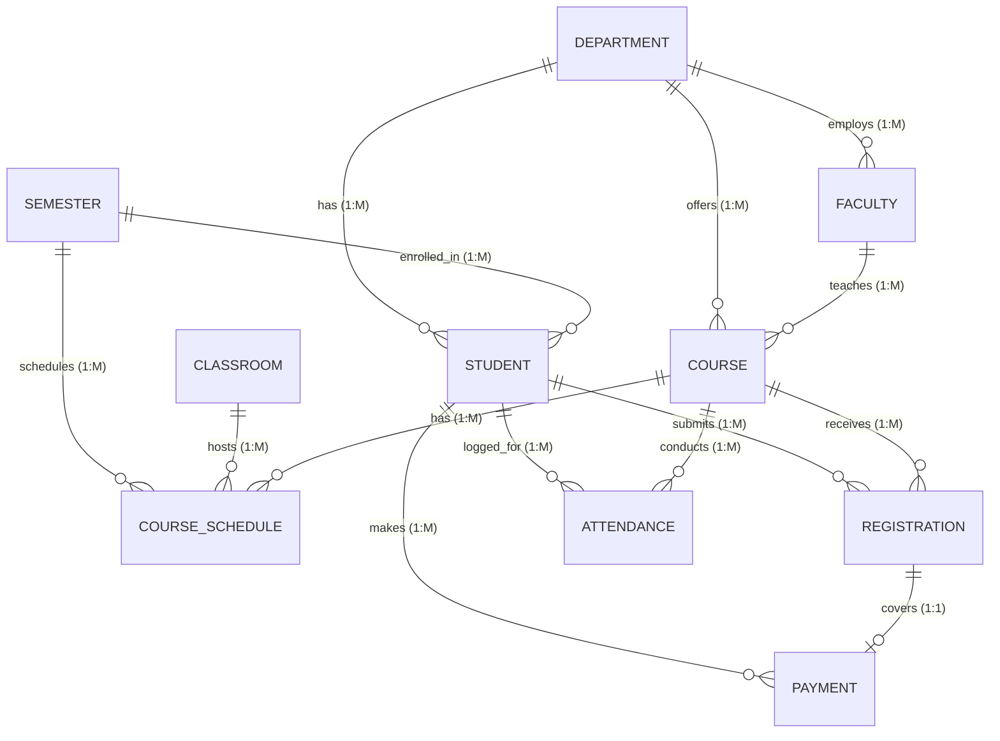

# CRMS Database Architecture & Design Document

**Course Registration and Management System (CRMS)**  
**DBMS Project — Review 2**  
Vellore Institute of Technology, Vellore  
Academic Year: 2026–27  

---

## 1. Relational Schema and Entity Definitions

The CRMS database strictly implements the 10 core entities established in Review 1, supplemented by an `admin` entity for RBAC.

### Table Definitions & Keys

| Table | Primary Key | Candidate Keys | Foreign Keys | Key Constraints |
| :--- | :--- | :--- | :--- | :--- |
| `department` | `department_id` | `department_name` | None | `UNIQUE(department_name)` |
| `semester` | `semester_id` | `(semester_name, academic_year)` | None | `CHECK (end_date > start_date)` |
| `admin` | `admin_id` | `username`, `email` | None | Secure Werkzeug hash |
| `faculty` | `faculty_id` | `email` | `department_id` -> `department` | `ON UPDATE CASCADE ON DELETE RESTRICT` |
| `student` | `student_id` | `roll_no`, `email`, `phone` | `department_id`, `semester_id` | `CHECK (gender IN ('Male','Female','Other'))` |
| `classroom` | `room_id` | `(room_number, building)` | None | `CHECK (capacity > 0)` |
| `course` | `course_id` | `course_code` | `department_id`, `faculty_id` | `CHECK (credits BETWEEN 1 AND 6)`, `maximum_seats > 0` |
| `registration` | `registration_id` | `(student_id, course_id)` | `student_id`, `course_id` | `CHECK (registration_status IN ('Pending','Approved'))` |
| `course_schedule` | `schedule_id` | `(room_id, semester_id, day, start_time)` | `course_id`, `semester_id`, `room_id` | `CHECK (end_time > start_time)` |
| `attendance` | `attendance_id` | `(student_id, course_id, attendance_date)` | `student_id`, `course_id` | `CHECK (status IN ('Present','Absent'))` |
| `payment` | `payment_id` | None | `student_id`, `registration_id` | `CHECK (amount > 0)`, `CHECK (payment_status IN ('Successful','Pending'))` |

---

## 2. Normalization Analysis

### 2.1 First Normal Form (1NF)
All attributes in each table contain only atomic, scalar values. Repeating groups such as registration details or schedules are factored out into independent child entities (`registration`, `course_schedule`, `attendance`).

### 2.2 Second Normal Form (2NF)
The schema satisfies 1NF and contains zero partial functional dependencies. In tables with composite candidate keys:
- In `registration(student_id, course_id)`: Non-prime attributes (`registration_date`, `registration_status`) depend on the whole composite key.
- In `course_schedule`: Attributes depend strictly on `schedule_id`.

### 2.3 Third Normal Form (3NF)
The schema satisfies 2NF and has zero transitive dependencies:
- Student facts do not store department building or HOD name; they store foreign key `department_id` referencing `department`.
- Course facts do not store instructor email or qualification; they reference `faculty_id`.

### 2.4 Boyce-Codd Normal Form (BCNF)
For every functional dependency $X \rightarrow Y$, $X$ is a superkey. Therefore, anomalies (insert, update, delete) are strictly eliminated.

---

## 3. Database Objects (Views, Stored Procedures, Functions, Triggers)

### 3.1 Views
1. `registration_details`: Denormalized join of registrations, students, courses, departments, and faculty.
2. `course_seat_availability`: Dynamically computes confirmed enrollments, pending counts, and real-time remaining seats.
3. `student_attendance_summary`: Aggregate calculations of lectures held, attended, missed, and attendance percentage.
4. `payment_summary`: Financial rollup per student, preventing cartesian multiplication through independent grouping.
5. `student_timetable_view`: Combines course schedules, instructors, and rooms for personal timetables.

### 3.2 Stored Procedures & Functions
- **`sp_register_student_course`**: Concurrency-safe procedure implementing pessimistic row-locking (`FOR UPDATE`) on course capacity, credit limit checking, duplicate prevention, and pending registration creation.
- **`sp_approve_registration`**: Verifies payment status and verifies capacity before transitioning status to `Approved`.
- **`sp_drop_registration`**: Ensures student ownership before deletion and cleans dependent allocations.
- **`sp_generate_enrollment_report`**: Department-filtered academic enrollment report.
- **`fn_course_available_seats(p_course_id)`**: Calculates remaining seats.
- **`fn_student_attendance_percentage(p_student_id, p_course_id)`**: Calculates attendance percentage.

### 3.3 Triggers
- **`trg_check_attendance_registration`**: `BEFORE INSERT ON attendance` — Prevents recording attendance unless the student has an `Approved` registration for the course.
- **`trg_prevent_classroom_overlap_insert` / `update`**: `BEFORE INSERT / UPDATE ON course_schedule` — Detects and rejects overlapping classroom bookings and faculty double-booking.
- **`trg_check_classroom_capacity`**: Enforces that room capacity is greater than or equal to course maximum seats.
